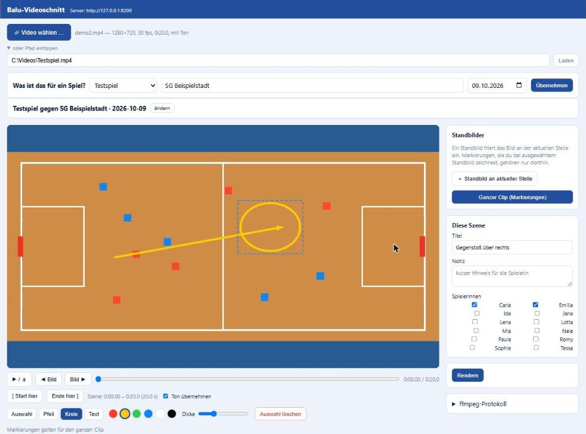

# Balu-Videoschnitt

*Local desktop tool to cut single scenes from a match recording, annotate them
(arrows, circles, text, freeze frames) and upload the finished clip to the
Balu's Training app. Hand-written canvas editor over a `<video>` element,
FastAPI backend, an ffmpeg pipeline that overlays browser-rendered PNG layers so
the output matches the editor exactly. No frontend libraries.*

---

Lokales Werkzeug am PC, um aus einer Spielaufzeichnung einzelne Szenen zu
schneiden, sie zu beschriften (Pfeile, Kreise, Text, Standbilder) und den
fertigen Clip zu **Balu's Training** hochzuladen. Dort sehen die zugeordneten
Spielerinnen die Szene unter „Ich → Videos".

## Screenshots

<!-- docs/screenshot-*.png — Editor mit geladenem Testvideo und Markierungen -->



Warum ein eigenes Programm und nicht direkt in der App: Schneiden und
Neukodieren ist rechenintensiv. Der Homeserver, auf dem Balu's Training läuft,
kann das nicht (2 Kerne, keine GPU). Also passiert das Rendern hier am PC; der
Server bekommt nur das fertige MP4 und liefert es aus.

## Einrichten

```bash
py -m pip install -r requirements.txt
winget install Gyan.FFmpeg          # ffmpeg + ffprobe, danach neues Terminal
cp .env.example .env                # BALU_URL + Trainer-Zugang eintragen
```

`ffmpeg` und `ffprobe` müssen im PATH sein. Alternativ die vollen Pfade in der
`.env` setzen (`FFMPEG=`, `FFPROBE=`).

Die `.env` braucht einen **Trainer-Zugang** von Balu's Training. Damit lädt das
Werkzeug hoch. Achtung: die App sperrt den Zugang nach 3 falschen PIN-Versuchen —
bei „Login fehlgeschlagen" die PIN prüfen, nicht blind neu starten.

## Starten

**Per Doppelklick:** die Verknüpfung **„Balu Videoschnitt"** auf dem Desktop.
Sie startet `starten.bat`; ein Fenster mit dem Protokoll bleibt offen, der
Browser öffnet den Editor nach ein, zwei Sekunden von selbst. Fenster schließen
beendet das Programm.

**Aus dem Terminal:**

```bash
py app.py
```

Dann `http://127.0.0.1:8300` im Browser öffnen.

`ffmpeg`/`ffprobe` findet das Werkzeug selbst, auch wenn sie noch nicht im PATH
stehen (frisch nach der winget-Installation): es sucht an der
winget-Installationsstelle und ein paar üblichen Pfaden. Notfalls die vollen
Pfade in die `.env` schreiben (`FFMPEG=`, `FFPROBE=`).

Die Desktop-Verknüpfung neu anlegen (falls sie fehlt oder der Ordner umzieht):

```powershell
$w = New-Object -ComObject WScript.Shell
$l = $w.CreateShortcut("$env:USERPROFILE\Desktop\Balu Videoschnitt.lnk")
$l.TargetPath = "$PWD\starten.bat"; $l.WorkingDirectory = "$PWD"
$l.IconLocation = "$env:SystemRoot\System32\imageres.dll,127"; $l.Save()
```

## Ablauf im Editor

1. **„Video wählen …"** — es öffnet sich der Windows-Dateidialog im
   Videos-Ordner. Die Datei wird an Ort und Stelle gelesen, nicht kopiert.
   (Alternativ „oder Pfad eintippen".)
2. **„Was ist das für ein Spiel?"** — Art (Testspiel, Ligaspiel, …), Gegner und
   Datum eintragen, „Übernehmen". Das gilt für alle Szenen aus dieser Aufnahme
   und steht später bei der Spielerin in der Notiz („Testspiel gegen Söflingen").
3. Zur Szene spulen. `[` setzt den Start, `]` das Ende. Leertaste = Play/Pause,
   Komma / Punkt = ein Bild zurück / vor.
4. **Markierungen** zeichnen: Pfeil, Kreis, Text; Farbe und Dicke wählen. Mit
   „Auswahl" verschiebst oder löschst du eine Form. Was du hier zeichnest, gilt
   für den ganzen Clip.
5. **Standbild** (optional): „＋ Standbild an aktueller Stelle". Das friert das
   Bild dort ein (Dauer einstellbar). Solange ein Standbild in der Liste
   ausgewählt ist, gehören neue Markierungen nur zu diesem Standbild. Zurück zum
   ganzen Clip über „Ganzer Clip".
6. **Titel und Notiz der Szene** eintragen, **Spielerinnen** ankreuzen.
7. **Rendern** — läuft lokal mit ffmpeg. Danach kannst du das Ergebnis ansehen.
8. **An Balu's Training senden** — der Clip landet in der App bei den gewählten
   Spielerinnen.

### Wenn der Kader nicht erscheint

Der Kader kommt live aus Balu's Training. Dafür müssen in der `.env`
`BALU_TRAINER_NAME` und `BALU_TRAINER_PIN` stehen **und** Balu's Training
erreichbar sein. Nach dem Nachtragen genügt „Erneut versuchen" (kein Neustart).
Ein einmal geladener Kader wird zwischengespeichert (`kader_cache.json`) und
steht danach auch ohne Verbindung zur Auswahl.

## Aufbau

| Datei | Zweck |
|---|---|
| `starten.bat` | Doppelklick-Start (Ziel der Desktop-Verknüpfung); ruft `py app.py` |
| `app.py` | FastAPI-Backend auf `127.0.0.1:8300`, liefert die Editor-Seite und die API |
| `render.py` | ffmpeg-Pipeline: Schnitt → feststehende Markierungen → Standbilder → concat |
| `balu_api.py` | Login bei Balu's Training, Kader holen, fertigen Clip hochladen |
| `static/` | der Editor (`index.html`, `schnitt.js`, `schnitt.css`), ohne externe Bibliotheken |
| `arbeit/`, `render/` | Zwischen- und Ausgabedateien, nur lokal (nicht im Repo) |

## Wie die Pipeline arbeitet (`render.py`)

Der Browser zeichnet die Markierungen auf einer Canvas-Ebene in
Ausgabeauflösung (1280×720) und schickt sie als **fertige transparente PNGs**
mit. ffmpeg rastert also nichts selbst — dadurch sieht das Ergebnis genauso aus
wie im Editor, und es gibt keinen Ärger mit Schriftarten.

1. **Schnitt + Normalisieren:** `-ss/-t` schneidet die Szene, alles wird auf
   1280×720 skaliert und (bei anderem Seitenverhältnis) mit schwarzen Rändern
   gefüllt, konstante Bildrate. H.264, `+faststart`.
2. **Feststehende Markierungen:** die Clip-PNGs werden per `overlay` mit
   Zeitfenster (`enable='between(t,…)'`) daraufgelegt.
3. **Standbilder:** der Clip wird an jedem Standbild-Zeitpunkt geteilt. Für jedes
   Standbild wird der Frame aus dem schon markierten Video gezogen, für die
   eingestellte Dauer als Standbild kodiert und die Standbild-Markierung
   daraufgelegt. Alle Teile haben identische Kodier-Parameter und werden per
   `concat`-Demuxer zusammengehängt.

## Grenzen (v1)

- Markierungen stehen fest über dem Clip bzw. einem Standbild. Eine Markierung,
  die einer laufenden Spielerin folgt, gibt es nicht.
- Kein Projekt-Speichern: ein Schnitt wird in einem Durchgang gemacht.
